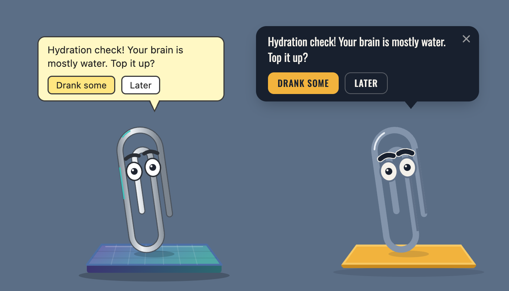
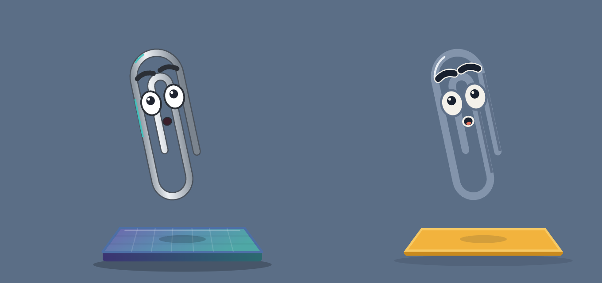
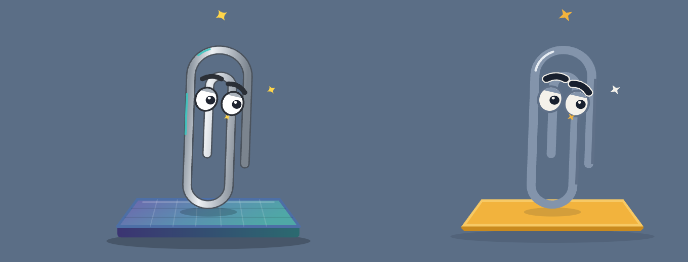

# Paperclip

A desktop assistant in the spirit of the 90s office helper: a paperclip that lives on your desktop, says hi, tells jokes, offers quotes, naps, gets dizzy, and reminds you to drink water. It's built with [Tauri 2](https://tauri.app), so it's small (a ~2 MB download) and uses almost no CPU while idle.

The character is original artwork. Paperclip is not affiliated with Microsoft and doesn't use any Clippy assets.


## What he does

- **Talks:** greets you by time of day, shares quotes, tells jokes and drops "It looks like you're…" tips, without repeating himself until he's run through them all.
- **Says hello when you unlock your screen**, with a different line depending on how long you were away.
- **Water reminders:** every 30, 45, 60 or 90 minutes between 8 am and 10 pm, with **Drank some** / **Later** buttons and a daily glass count.
- **Stretch breaks:** after an hour of steady use (30, 45, 60 or 90 minutes) he stretches on his mat and invites you to join a 30-second guided stretch.
- **Focus timer:** 15, 25, 45 or 60 minutes from the menu, or any length from 1 to 180 minutes by asking him ("start a 40 minute timer"). He sets a timer on his mat, stays quiet until it rings, then celebrates. The menu-bar icon shows the minutes left.
- **Meeting heads-up (macOS, opt-in):** a nudge 5 minutes before calendar events. Calendar access is only requested when you turn it on.
- **Notices your computer:** hides while you present or watch something full screen and comes back after, dances when music plays, sweats when the CPU is pegged, gets tired on low battery and yawns late at night.
- **Seasonal outfits:** a pumpkin, Santa hat, party hat, heart or shamrock on the right days (turn off under **Style**).
- **Answers questions (optional, free by default):** *Ask Paperclip* sends a short question to a model on [OpenRouter](https://openrouter.ai) and shows the answer in his balloon (1 to 3 sentences). It works out of the box with a free model (Gemma 4 31B): you only need a free OpenRouter API key ([create one here](https://openrouter.ai/keys)). You can switch to Claude Haiku 5.5 (paid on OpenRouter) or any other OpenRouter model id (**Other model…**). Want it faster? Switch the provider to **Groq**: its free tier needs no payment and is very fast (create a key at [console.groq.com/keys](https://console.groq.com/keys)); answers use Qwen 3.8 27B by default, GPT-OSS 120B as the smarter choice, or any other Groq model id, and are capped to a few short sentences. If the free tier's rate limit is hit he says how long to wait. Prefer the Claude API directly? Switch the provider to **Claude (Anthropic)** and add an Anthropic API key. Keys are kept in your system keychain (one per provider: OpenRouter, Groq, Claude), and never shown again. Only the text you type and the last few turns of the chat go to the provider and the model you picked: no screen, clipboard or files. Free models have tight rate limits, so he may ask you to try again in a bit.
  **Things you can ask him** (he answers these himself: no network, no API key needed):
  - *"Who made you?"*, *"What can you do?"*: he introduces himself.
  - *"Can you dance?"*, *"blink"*, *"jump"*, *"wave"*, *"look left"*, *"take a nap"*: he does it (also wink, stretch, yawn, spin, celebrate, think, look right/up/down).
  - *"Start a 25 minute timer"*, *"pomodoro"*, *"how much time is left?"*, *"stop the timer"*: the focus timer (1 to 180 minutes).
  - *"Remind me to drink water"*, *"I drank a glass of water"*: turns the water reminders on, or logs a glass.
  - *"Tell me a joke"*, *"Give me a quote"*, *"Let's stretch"*: a joke, a quote, or the guided stretch.
  - *"Go away"*: hides him. *"Change style"*, *"flat style"*: switches the look.
  
  Anything else goes to the AI as before.
- **Lives:** blinks, looks around, fidgets, dozes off when you leave him alone, and enters and leaves with a yoga mat in several different ways.
- **Two styles:** *Classic* (glossy) and *Flat* (geometric, set in Oswald). Switch between them at any time.
- **Stays out of the way:** clicks on the empty parts of his window pass through to the apps underneath, and he never takes keyboard focus, except while you are typing a question to Ask Paperclip.



| Asleep | Bouncing on the mat | Dizzy |
|---|---|---|
|  |  |  |

## How to play with him

| Do this | He does this |
|---|---|
| Click him | Notices you, and his eyes follow your cursor anywhere on screen (click again, or stop moving for 8 s, to end it) |
| Double-click him | Tells a joke |
| Triple-click him, or middle-click him | Shares a quote |
| Double middle-click him, or right-click him twice quickly | Opens **Ask Paperclip** |
| Fling him (drag and let go fast) | He flies, bounces off the screen edges and gets dizzy if it was rough |
| Drop a file or folder on him | Offers to zip it next to the original |
| Choose **Ask Paperclip** > **Ask a question…** | A box opens in his balloon: type, press Enter to send, Esc to cancel. Things he can do himself ("start a 25 minute timer", "tell me a joke", "who made you?") are answered on the spot, with no key and nothing sent. The first time he asks for your [OpenRouter API key](https://openrouter.ai/keys) (**Set OpenRouter API key…** / **Remove API key**, the **OpenRouter / Groq / Claude (Anthropic)** provider choice (the key item then reads **Set Groq API key…**, with a key from [console.groq.com/keys](https://console.groq.com/keys)) and the model choice live in the same submenu). Answers offer **Reply** and **Done** |
| Tap the yoga mat | Bounces like it's a trampoline. Keep tapping to keep him jumping |
| Drag him | Moves wherever you drop him. Whip him around fast and he gets dizzy |
| Hover over him while he sleeps | Wakes up |
| Right-click him (it opens after a 0.4 s pause), or click the menu-bar icon | Opens the menu: say hi, joke, quote, nap, style and outfits, quiet mode, ask a question (OpenRouter, Groq or Claude), wellbeing (water, stretch, focus timer, meetings), presence, unlock greeting, updates, launch at login, quit |

Left-clicking the menu-bar icon brings him back if you've hidden him.

## Install

### macOS (Apple Silicon)

1. Build the installer (see [Build from source](#build-from-source)), or get `Paperclip_0.1.0_aarch64.dmg` from whoever shared it with you.
2. Open the `.dmg` and drag **Paperclip** into **Applications**.
3. The app isn't signed yet, so macOS blocks the first launch. Right-click Paperclip in Applications, choose **Open**, then confirm **Open**. You only need to do this once.

He appears in the bottom-right of your screen, and a paperclip icon appears in the menu bar. To start him automatically, turn on **Launch at login** in his menu.

Intel Macs need a universal build: `npm run tauri build -- --target universal-apple-darwin`. Run `rustup target add x86_64-apple-darwin` first.

### Windows and Linux

These platforms aren't tested yet. Build on the target OS with the same steps below; Tauri produces an `.msi`/`.exe` on Windows and an `.AppImage`/`.deb` on Linux. On Linux under Wayland there's no global cursor position, so clicks don't pass through the transparent area and eye-follow doesn't work. Launch with `GDK_BACKEND=x11` for the full behaviour.

## Build from source

You'll need [Node.js](https://nodejs.org) 20.19 or newer, [Rust](https://rustup.rs) (stable), and the [Tauri prerequisites](https://tauri.app/start/prerequisites/) for your OS (on macOS, just the Xcode Command Line Tools).

```bash
git clone https://github.com/annuai/paperclip.git
cd paperclip
npm install
```

Run it in development mode:

```bash
npm run tauri dev
```

Build the release app and installer:

```bash
npm run tauri build
```

The output lands in `src-tauri/target/release/bundle/`: `macos/Paperclip.app` and `dmg/Paperclip_<version>_aarch64.dmg` on macOS.

A local build does not need the updater signing key: update artifacts (`.tar.gz` and `.sig`) are only produced when the release config is added (`--config src-tauri/tauri.release.conf.json`), and that is what the release workflow does. To test the updater bundle locally, set `TAURI_SIGNING_PRIVATE_KEY` to the key's contents (or path) and `TAURI_SIGNING_PRIVATE_KEY_PASSWORD` to an empty string, then add that flag.

If the `.dmg` step fails with "Resource busy", an earlier Paperclip disk image is still mounted. Eject it in Finder, or run this, then rebuild:

```bash
hdiutil info | grep /Volumes/Paperclip | awk '{print $1}' | xargs -I{} hdiutil detach {} -force
```

## Releases

Releases are built by GitHub Actions (`.github/workflows/release.yml`) from a version tag. CI (`.github/workflows/ci.yml`) runs tests, typecheck and clippy on every push to `main` and every pull request.

### Cut a release

1. Bump the version in all three places, to the same number: `version` in `src-tauri/tauri.conf.json`, `package.json` and `src-tauri/Cargo.toml` (then run `cargo check --manifest-path src-tauri/Cargo.toml` or `npm install` so the lock files follow).
2. Commit, then tag and push the tag: `git tag v0.2.0 && git push origin v0.2.0`.
3. The workflow builds macOS (universal), Windows and Linux, and creates a **draft** release with the installers, the signed updater bundles and `latest.json`.
4. Check the draft, then publish it. Publishing is what makes `latest.json` the "latest" one, so existing installs start to see the update.
5. Optional: update the Homebrew cask (see `packaging/README.md`).

### GitHub secrets

Add these under Settings > Secrets and variables > Actions:

| Secret | Needed for |
|---|---|
| `TAURI_SIGNING_PRIVATE_KEY` | Required. Contents of the updater private key file (see below). |
| `TAURI_SIGNING_PRIVATE_KEY_PASSWORD` | The key's password. The current key has none, so leave this empty or unset. |
| `APPLE_CERTIFICATE` | Optional: base64 of the Developer ID Application `.p12`. |
| `APPLE_CERTIFICATE_PASSWORD` | Optional: password of that `.p12`. |
| `APPLE_SIGNING_IDENTITY` | Optional: e.g. `Developer ID Application: Name (TEAMID)`. |
| `APPLE_ID`, `APPLE_PASSWORD`, `APPLE_TEAM_ID` | Optional: notarization (an app-specific password, not your Apple ID password). |

Without the Apple secrets the macOS build still succeeds, just unsigned (users right-click > Open the first time). Signing happens only when `APPLE_CERTIFICATE` is set; notarization only when all three Apple ID secrets are set too.

### The updater key

The updater verifies downloads against a public key that is built into the app (`plugins.updater.pubkey` in `src-tauri/tauri.conf.json`). The matching **private key lives outside the repo at `~/.tauri/paperclip.key`** on the machine that generated it. Never commit it. Copy its contents into the `TAURI_SIGNING_PRIVATE_KEY` secret and keep a backup: if it is lost, installed copies can never be updated and need a manual reinstall. Rotating the key has the same effect.

### The repo must be public for updates

The app checks `https://github.com/annuai/paperclip/releases/latest/download/latest.json`. While the repo is private that URL answers 404 to everyone who is not logged in, so "Check for updates…" can only say it couldn't check (and the daily silent check stays quiet). Make the repo public before shipping a release to anyone else. The same goes for the Homebrew cask download.

## Development

| Command | What it does |
|---|---|
| `npm test` | Runs the Vitest suite (animations, scheduler, reminders, eye-follow, interaction, skins) |
| `npm run typecheck` | Type-checks the TypeScript |
| `npm run lint:rs` | Runs `cargo clippy` with warnings as errors |
| `npm run dev`, then open `http://localhost:1420/?sandbox&compare` | Animation sandbox: plays every animation in both styles side by side, in a normal browser |
| `./scripts/screenshots.sh` | Regenerates the README screenshots (needs Chrome, ffmpeg and the dev server running) |

### Project layout

```
src/
  anim/       pose system, animation catalogue, animator
  art/        SVG skins (Classic and Flat) and renderer
  agent/      behaviour: scheduler, sleep, dizzy, jumps, hydration, eye-follow, unlock greeting
  content/    greetings, quotes, jokes, tips and reminder lines (JSON)
  ui/         speech balloon, context menu, mouse interaction, hit areas
  platform/   settings persistence and Tauri bindings
src-tauri/
  src/        tray menu, click-through and cursor polling, lock/unlock watcher
docs/         design brief, screenshots
```

The Flat style's design rules are in [DESIGN.md](DESIGN.md), and the product notes are in [PRODUCT.md](PRODUCT.md).
