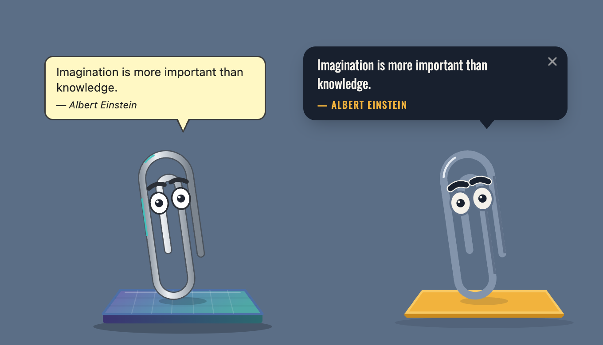
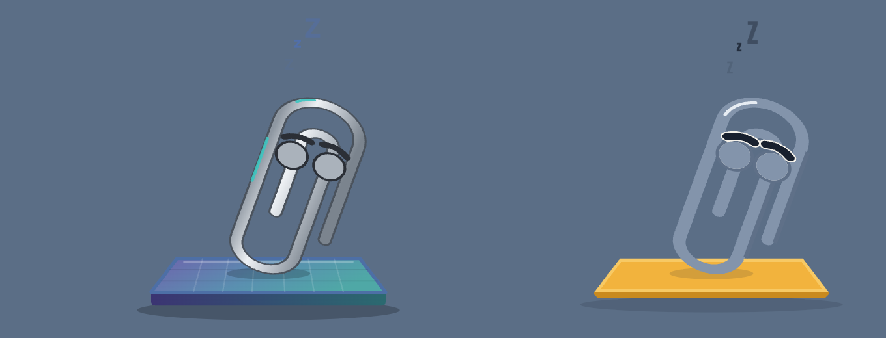

# Paperclip

A desktop assistant in the spirit of the 90s office helper: a paperclip that lives on your desktop, says hi, tells jokes, offers quotes, naps, gets dizzy, and reminds you to drink water. It's built with [Tauri 2](https://tauri.app), so it's small (a ~2 MB download) and uses almost no CPU while idle.

The character is original artwork. Paperclip is not affiliated with Microsoft and doesn't use any Clippy assets.



## What he does

- **Talks:** greets you by time of day, shares quotes, tells jokes and drops "It looks like you're…" tips, without repeating himself until he's run through them all.
- **Says hello when you unlock your screen**, with a different line depending on how long you were away.
- **Water reminders:** every 30, 45, 60 or 90 minutes between 8 am and 10 pm, with **Drank some** / **Later** buttons and a daily glass count.
- **Answers questions (optional):** *Ask Paperclip* sends a short question to Claude and shows the answer in his balloon (1 to 3 sentences). You bring your own Anthropic API key, kept in your system keychain and never shown again. Only the text you type and the last few turns of the chat are sent: no screen, clipboard or files. Pick Haiku (fast, default) or Sonnet in the submenu.
- **Lives:** blinks, looks around, fidgets, dozes off when you leave him alone, and enters and leaves with a yoga mat in several different ways.
- **Two styles:** *Classic* (glossy) and *Flat* (geometric, set in Oswald). Switch between them at any time.
- **Stays out of the way:** clicks on the empty parts of his window pass through to the apps underneath, and he never takes keyboard focus, except while you are typing a question to Ask Paperclip.


| Asleep | Bouncing on the mat | Dizzy |
|---|---|---|
|  |  |  |

## How to play with him

| Do this | He does this |
|---|---|
| Click him | Notices you, and his eyes follow your cursor anywhere on screen (click again, or stop moving for 8 s, to end it) |
| Double-click him | Tells a joke |
| Triple-click him | Shares a quote |
| Fling him (drag and let go fast) | He flies, bounces off the screen edges and gets dizzy if it was rough |
| Drop a file or folder on him | Offers to zip it next to the original |
| Choose **Ask Paperclip** > **Ask a question…** | A box opens in his balloon: type, press Enter to send, Esc to cancel. The first time he asks for your Claude API key (**Set Claude API key…** / **Remove API key** live in the same submenu). Answers offer **Reply** and **Done** |
| Tap the yoga mat | Bounces like it's a trampoline. Keep tapping to keep him jumping |
| Drag him | Moves wherever you drop him. Whip him around fast and he gets dizzy |
| Hover over him while he sleeps | Wakes up |
| Right-click him, or click the menu-bar icon | Opens the menu: say hi, joke, quote, nap, style, quiet mode, ask Claude, water reminders, unlock greeting, launch at login, quit |

Left-clicking the menu-bar icon brings him back if you've hidden him.

## Install

### macOS (Apple Silicon)

1. Build the installer (see [Build from source](#build-from-source)), or get `Paperclip_0.1.0_aarch64.dmg` from whoever shared it with you.
2. Open the `.dmg` and drag **Paperclip** into **Applications**.
3. The app isn't signed yet, so macOS blocks the first launch. Right-click Paperclip in Applications, choose **Open**, then confirm **Open**. You only need to do this once.

He appears in the bottom-right of your screen, and a paperclip icon appears in the menu bar. To start him automatically, turn on **Launch at login** in his menu.

Intel Macs need a universal build: `npm run tauri build -- --target universal-apple-darwin`. Run `rustup target add x86_64-apple-darwin` first.

### Windows and Linux

These platforms aren't tested yet. Build on the target OS with the same steps below; Tauri produces an `.msi`/`.exe` on Windows and an `.AppImage`/`.deb` on Linux. On Linux under Wayland there's no global cursor position, so clicks don't pass through the transparent area and eye-follow doesn't work. Launch with `GDK_BACKEND=x11` for the full behaviour.

## Build from source

You'll need [Node.js](https://nodejs.org) 20.19 or newer, [Rust](https://rustup.rs) (stable), and the [Tauri prerequisites](https://tauri.app/start/prerequisites/) for your OS (on macOS, just the Xcode Command Line Tools).

```bash
git clone https://github.com/annuai/paperclip.git
cd paperclip
npm install
```

Run it in development mode:

```bash
npm run tauri dev
```

Build the release app and installer:

```bash
npm run tauri build
```

The output lands in `src-tauri/target/release/bundle/`: `macos/Paperclip.app` and `dmg/Paperclip_<version>_aarch64.dmg` on macOS.

If the `.dmg` step fails with "Resource busy", an earlier Paperclip disk image is still mounted. Eject it in Finder, or run this, then rebuild:

```bash
hdiutil info | grep /Volumes/Paperclip | awk '{print $1}' | xargs -I{} hdiutil detach {} -force
```

## Development

| Command | What it does |
|---|---|
| `npm test` | Runs the Vitest suite (animations, scheduler, reminders, eye-follow, interaction, skins) |
| `npm run typecheck` | Type-checks the TypeScript |
| `npm run lint:rs` | Runs `cargo clippy` with warnings as errors |
| `npm run dev`, then open `http://localhost:1420/?sandbox&compare` | Animation sandbox: plays every animation in both styles side by side, in a normal browser |
| `./scripts/screenshots.sh` | Regenerates the README screenshots (needs Chrome, ffmpeg and the dev server running) |

### Project layout

```
src/
  anim/       pose system, animation catalogue, animator
  art/        SVG skins (Classic and Flat) and renderer
  agent/      behaviour: scheduler, sleep, dizzy, jumps, hydration, eye-follow, unlock greeting
  content/    greetings, quotes, jokes, tips and reminder lines (JSON)
  ui/         speech balloon, context menu, mouse interaction, hit areas
  platform/   settings persistence and Tauri bindings
src-tauri/
  src/        tray menu, click-through and cursor polling, lock/unlock watcher
docs/         design brief, implementation plan, screenshots
```

The Flat style's design rules are in [DESIGN.md](DESIGN.md), and the product notes are in [PRODUCT.md](PRODUCT.md).
